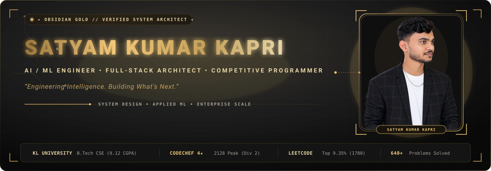
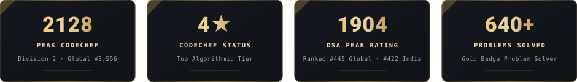
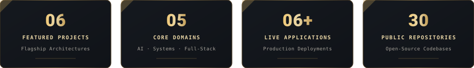
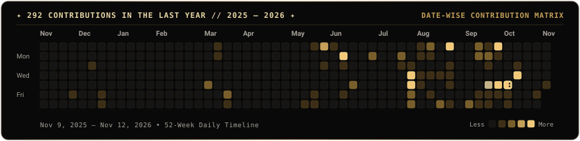
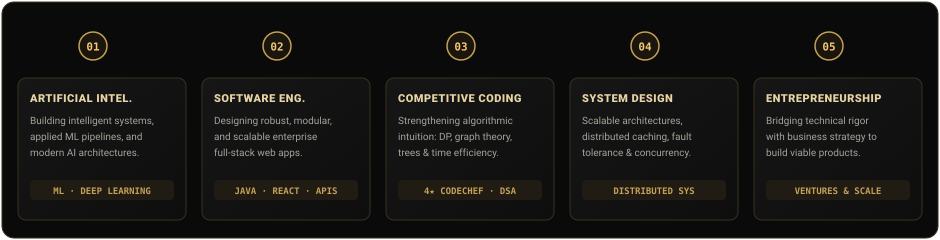

<!-- ========================================================================= -->
<!-- SATYAM KUMAR KAPRI // ROYAL OBSIDIAN GOLD — ELITE ENGINEERING EDITION    -->
<!-- Personal Portfolio: https://satyamkapriportfolio.vercel.app              -->
<!-- GitHub: https://github.com/satyamkumarkapri                               -->
<!-- ========================================================================= -->

  

    

  <!-- Quick Access Navigation Strip -->
  
  &nbsp;
  
  &nbsp;
  
  &nbsp;
  
  &nbsp;
  

    

  

## 01 / THE ENGINEER

Hello, I'm **Satyam Kumar Kapri**.

I'm a second-year Computer Science and Engineering student at **KL University**, passionate about software engineering, artificial intelligence, machine learning, and solving complex computational problems.

I enjoy transforming ideas into practical applications, understanding the architecture behind intelligent systems, and building scalable software solutions. My interests lie at the intersection of engineering, innovation, and business.

 

  

 

  

## 02 / PROBLEM SOLVING & RECOGNITION

My verified competitive programming and algorithmic credentials:

 

  

 

<table>
<tr>
<td width="50%" valign="top">

### 🏆 CodeChef Credentials
- **Competitive Status:** **4★ Programmer** (Division 2)
- **Peak Contest Rating:** **2128** (Ranked **#3,556** Globally & **#3,112** in India)
- **DSA Peak Rating:** **1904** (Ranked **#445** Globally & **#422** in India)
- **Volume Solved:** **640+** Algorithmic Challenges Solved
- **Badge Awarded:** CodeChef Gold Badge Problem Solver
- **Official Handle:** [`kl_2500031975`](https://www.codechef.com/users/kl_2500031975)

</td>
<td width="50%" valign="top">

### ⚡ LeetCode & Hackathons
- **Contest Rating:** **1,780** (Top **9.35%** Globally · Rank **#81,796**)
- **Problems Solved:** **153** (80 Easy, 56 Medium, 17 Hard) in Java
- **Adobe University Hackathon:** Cleared Round 1 (Online Assessment – MCQ + Coding, Aug 2026)
- **TVS Credit E.P.I.C 8.0:** Analytics Challenge Finalist / Participant (Team Elite Minds, Oct 2026)
- **Automation Anywhere:** Certified Essentials Automation Professional (RPA Club, KL University)
- **Official Handle:** [`satyamkapri17`](https://leetcode.com/u/satyamkapri17/)

</td>
</tr>
</table>

  

## 03 / TECHNOLOGY & ENGINEERING STACK

Curated technologies across enterprise systems, machine learning pipelines, and full-stack platforms:

 

  

 

<table>
<tr>
<td width="50%" valign="top">

#### 💻 Programming Languages
`Java (Core, Multithreading & OOP)` `Python 3` `TypeScript` `JavaScript (ES6+)` `C / C11` `SQL` `HTML5` `CSS3`

#### 🌐 Frontend Engineering
`React` `Next.js` `Vite` `Tailwind CSS` `Framer Motion` `Responsive UI Design` `REST Clients`

#### ⚙️ Backend & Distributed Systems
`Spring Boot` `Node.js` `Express.js` `FastAPI` `RESTful APIs` `Microservices` `JWT & Auth`

</td>
<td width="50%" valign="top">

#### 🧠 AI & Machine Learning
`NumPy` `Pandas` `Scikit-learn` `Hugging Face` `Deep Learning Pipelines` `Feature Engineering` `Predictive Modeling`

#### 🗄️ Databases & Data Storage
`PostgreSQL` `MongoDB` `Schema Design & Normalization` `Query Optimization & Indexing` `Aggregation Pipelines`

#### 🛠️ Developer Tools & Infrastructure
`Git` `GitHub` `Docker` `Linux / Bash` `Postman` `VS Code` `Vercel` `Render` `Hugging Face Spaces`

</td>
</tr>
</table>

  

## 04 / SELECTED ENGINEERING PROJECTS

Architectural implementations, intelligent applications, systems software, and production-oriented products.

  

 

### 🌟 Level 1 — Featured Engineering Systems

<table>
<tr>
<td width="50%" valign="top">

`01` · `AI / INTELLIGENT APPLICATIONS & GOVTECH`

### 🎯 [SkillTrack Maharashtra](https://github.com/satyamkumarkapri/Skill_Track_Sih)
*Skilling Outcomes & Impact Intelligence Platform · Smart India Hackathon (SIH 2026, Problem ID: 26135)*

A full-stack data intelligence platform engineered for the Government of Maharashtra to trace trainee journeys longitudinally from enrollment through certification, placement retention, and 24-month career progression.

**⚙️ Engineering Challenge:**
Replacing fragmented, multi-department Excel spreadsheets with a centralized, high-throughput reporting pipeline capable of reconciling historical job market data against real-time trainee self-reports, preventing duplicate records, and modeling longitudinal salary trajectories with irregular reporting intervals.

**🏗️ Architecture & Implementation:**
Built on Next.js 14 App Router and Node.js Server Actions with MongoDB aggregation pipelines. Designed a dynamic skill-demand scoring algorithm, unified glassmorphism shared trainee profiles (`/profile/[id]`), role-based access control (Admin, Training Provider, Employer, Trainee), and encrypted security-question recovery.

**🛠️ Tech Stack:**
     

**⚡ Key Capabilities:**
- **Dynamic Skill Gap Engine:** Calculates real-time market demand curves against actual regional trainee supply.
- **Longitudinal Career Timeline:** Permanent, immutable trainee job retention logging with reason-for-exit tracking.
- **Universal Shared Profiles:** Unified `/profile/[id]` with trainee privacy controls and employer verification consent.
- **Multi-Role Governance:** Four discrete role dashboards for state admins, training providers, employers, and candidates.

**🔗 Project Links:**
 

</td>
<td width="50%" valign="top">

`02` · `SYSTEMS ENGINEERING & ALGORITHMIC OPTIMIZATION`

### 🏙️ [SmartCityX](https://github.com/satyamkumarkapri/SmartCityX)
*Integrated Smart-City Analytics & Infrastructure Optimization Engine*

An enterprise-grade smart-city analytics engine combining Java 21, Spring Boot 3.2, and advanced Data Structures & Algorithms to solve large-scale municipal logistics, utility flow, and emergency resource allocation.

**⚙️ Engineering Challenge:**
Optimizing critical urban infrastructure networks (power grids, water flow, emergency vehicle dispatch) under NP-hard constraints while maintaining sub-second query latency across municipal document archives and real-time citizen incident logs.

**🏗️ Architecture & Implementation:**
Architected a modular Spring Boot system with PostgreSQL and Docker. Implemented Ford-Fulkerson, Edmonds-Karp, and Dinic's network flow algorithms for utility grids, 2-Approximation Vertex Cover for sensor placement, Suffix Arrays with Kasai LCP for document search, and KMP/Aho-Corasick for high-throughput citizen alert scanning.

**🛠️ Tech Stack:**
    

**⚡ Key Capabilities:**
- **Network Flow Optimization:** Dinic's & Edmonds-Karp algorithms maximizing municipal water and power delivery.
- **Suffix Automaton (SAM) Search:** Fast substring indexing and Kasai LCP across city documentation and records.
- **Emergency Resource Matching:** Bipartite matching allocating municipal fleets (ambulances, tankers) to active alerts.
- **Combinatorial Optimization:** Bitmask DP (Set Cover) & Vertex Cover approximation for minimum-cost facility distribution.

**🔗 Project Links:**
 

</td>
</tr>

<tr>
<td width="50%" valign="top">

`03` · `SYSTEMS PROGRAMMING & NETWORK ENGINEERING`

### ⚡ [MicroHTTP Server](https://github.com/satyamkumarkapri/Microhttp-concurrent-web-server)
*High-Concurrency HTTP/1.1 Web Server in C11*

A high-throughput, non-blocking HTTP/1.1 web server engineered in pure C11 using Linux sockets, epoll I/O multiplexing, and POSIX threads.

**⚙️ Engineering Challenge:**
Eliminating thread-per-connection scaling bottlenecks and memory leaks by handling thousands of concurrent client connections with deterministic low latency, non-blocking sockets, zero-copy static file transfers, and safe state machine request parsing.

**🏗️ Architecture & Implementation:**
Engineered an event-driven worker-thread pool architecture using Linux `epoll` in edge-triggered mode. Built a custom HTTP/1.1 state machine parser, robust socket keep-alive timers, connection state tracking, MIME-type mapping, and clean POSIX signal handlers (`SIGINT`, `SIGTERM`) for graceful thread joins and resource teardown.

**🛠️ Tech Stack:**
    

**⚡ Key Capabilities:**
- **Edge-Triggered epoll:** $O(1)$ event notifications scaling to thousands of concurrent socket descriptors.
- **Thread Pool Architecture:** Work queue decoupling connection listening from request execution to eliminate thrashing.
- **HTTP/1.1 Protocol Engine:** Robust parsing of headers, methods, query parameters, keep-alive, and chunked transfer.
- **Production Resource Hygiene:** Safe signal interception (`SIGINT`/`SIGTERM`) and valgrind-verified zero memory leakage.

**🔗 Project Links:**

</td>
<td width="50%" valign="top">

`04` · `HEALTHCARE SYSTEMS & BACKEND ARCHITECTURE`

### 🏥 [HealthNet](https://github.com/satyamkumarkapri/HealthNet)
*Intelligent Hospital Resource Management System*

An enterprise-grade, in-memory hospital resource orchestrator written in Java 17+ leveraging GoF design patterns and algorithmic triage to manage emergency workflows and critical assets.

**⚙️ Engineering Challenge:**
Coordinating emergency room patient flow, dynamic ICU bed/ventilator allocation, and surgeon availability in real time without external database latency, maintaining absolute thread safety and algorithmic priority under fluctuating trauma conditions.

**🏗️ Architecture & Implementation:**
Designed around thread-safe Singleton controllers for atomic state consistency, an event-driven Observer pattern triggering threshold alerts when critical physical inventory dips below 20%, and a Strategy pattern enabling runtime switching between QuickSort, HeapSort, and RadixSort in reporting modules.

**🛠️ Tech Stack:**
   

**⚡ Key Capabilities:**
- **Emergency Triage Engine:** Priority patient ranking driven by dynamic severity scoring (1-100) via Max-Heap (`PriorityQueue`).
- **Observer Alert Pipeline:** Real-time event notifications triggered whenever ICU beds or ventilator capacity dip below 20%.
- **Strategy Sorting Context:** Runtime polymorphic switching between QuickSort, HeapSort, and RadixSort for clinical audits.
- **In-Memory Graph Topology:** Zero-latency routing of patients and staff across hospital departments and specialties.

**🔗 Project Links:**
 

</td>
</tr>

<tr>
<td width="50%" valign="top">

`05` · `BACKEND MICROSERVICES & POLYGLOT PERSISTENCE`

### 📦 [CatalogX](https://github.com/satyamkumarkapri/Product_Catalog)
*API-Driven Product Catalog & E-Commerce Microservices Platform*

A high-scalability e-commerce platform demonstrating polyglot persistence across PostgreSQL and MongoDB Atlas with a FastAPI microservice gateway and semantic vector search.

**⚙️ Engineering Challenge:**
Resolving the architectural tension between strictly normalized relational data (ACID transactions, checkout ledgers, user authentication) and flexible high-throughput unstructured product attributes, while providing sub-millisecond semantic search.

**🏗️ Architecture & Implementation:**
Built with a polyglot microservices architecture: FastAPI (Python) serves as the high-speed API Gateway and routing layer, Node.js/Express manages NoSQL document operations and semantic vector embeddings in MongoDB Atlas, and PostgreSQL manages relational inventory schemas and ACID checkout records, secured by stateless JWT and RBAC.

**🛠️ Tech Stack:**
    

**⚡ Key Capabilities:**
- **Polyglot Persistence:** Combined PostgreSQL relational ledger with MongoDB Atlas unstructured catalog document store.
- **Intelligent API Gateway:** FastAPI service handling reverse proxy routing, CORS resolution, and request validation.
- **AI-Powered Semantic Search:** Vector similarity matching paired with deep category hierarchy and attribute indexing.
- **Enterprise Security:** Stateless JWT authentication with Role-Based Access Control (Admin, Vendor, Customer).

**🔗 Project Links:**
 

</td>
<td width="50%" valign="top">

`06` · `FULL-STACK WEB PLATFORM & EVENT LOGISTICS`

### 🎭 [Banka Dandiya 6.0](https://github.com/satyamkumarkapri/Banka)
*High-Performance Production Event & Ticketing Platform*

A high-performance, production event web platform serving thousands of attendees with real-time pass booking, animated schedules, and interactive logistics.

**⚙️ Engineering Challenge:**
Delivering an ultra-responsive, 60fps interactive web experience under peak burst traffic during ticket release windows, while preserving optimal asset compression, zero layout shifts, and mobile responsiveness.

**🏗️ Architecture & Implementation:**
Built with React, TypeScript, and Vite, using Tailwind CSS and Framer Motion for hardware-accelerated animations. Integrated responsive pass tier selection, modal-driven booking workflows, dynamic countdown timers, lazy-loaded media galleries, embedded venue mapping, and WhatsApp API integration.

**🛠️ Tech Stack:**
     

**⚡ Key Capabilities:**
- **Production Ticketing Interface:** Multi-tier pass booking with modal confirmation and WhatsApp customer logistics.
- **Hardware-Accelerated UX:** 60fps fluid UI animations with floating particle canvas and smooth scroll choreography.
- **Interactive Logistics:** Real-time event countdown clock, venue GPS coordinate mapping, and social sharing mechanics.
- **Zero-CLS Mobile Optimization:** High-efficiency bundle splitting and lazy-loaded galleries tuned for low-latency mobile devices.

**🔗 Project Links:**
 

</td>
</tr>
</table>

 

### 🗂️ Level 2 — More Engineering Work

A curated index of specialized systems software, algorithmic simulators, machine learning models, and production web platforms:

| Project | Core Domain & Focus | Primary Technologies | Verified Links |
| :--- | :--- | :--- | :--- |
| **HospNav AI** | Multi-floor hospital pathfinding with A*, UCS, IDA*, medical triage expert system, and CSP staff scheduling | `Python` `Flask` `Heuristic Search` `CSP` | [Codebase](https://github.com/satyamkumarkapri/HospitalNavigationSystem) · [Live App](https://hospitalnavigationsystem.onrender.com) |
| **COVID-19 Analysis** | Interactive data science visualizer & predictive regression dashboard for global pandemic time-series data | `Python` `Pandas` `Scikit-learn` `Gunicorn` | [Codebase](https://github.com/satyamkumarkapri/Covid-19-Data-Analysis) · [Hugging Face Space](https://huggingface.co/spaces/satyamkumarkapri/Covid-19DataAnalysis) |
| **CampusFind** | Full-stack centralized lost-and-found recovery platform with multi-campus isolation and role authentication | `React` `TypeScript` `Spring Boot` `Neon PG` | [Codebase](https://github.com/satyamkumarkapri/CampusFind) |
| **ShellForge** | Custom UNIX POSIX shell with tokenization, AST parser, command execution, piping, and history management | `C11` `UNIX Sockets` `POSIX API` `Makefile` | [Codebase](https://github.com/satyamkumarkapri/ShellForge) |
| **PhonePe Simulator** | Object-oriented transaction processor modeling double-entry ledgers, wallet states, and rollback stacks | `Java 17` `OOP Patterns` `Stack` `Queue` | [Codebase](https://github.com/satyamkumarkapri/PhonePeProjectPBL) |
| **Placements Prediction** | Machine learning classification model evaluating academic and aptitude metrics to forecast student placement | `Python` `Scikit-learn` `Flask` `Render` | [Codebase](https://github.com/satyamkumarkapri/Placements_Prediction) · [Live App](https://placements-prediction-8wt4.onrender.com) |
| **Kishan Traders** | Production commercial web application and digital product showcase for regional wholesale building materials | `React` `JavaScript` `Responsive UI` `Vercel` | [Live Website](https://kishan-traders.vercel.app) |

  

## 05 / ENGINEERING ACTIVITY

Dynamic GitHub analytics sourced directly from active contributions:

 

  <!-- Royal Obsidian Gold Statistics Dashboard -->
  
  &nbsp;
  

    

  <!-- Royal Obsidian Gold Streak Statistics -->
  

    

  <!-- Royal Obsidian Gold Activity Graph -->
  

    

  <!-- Date-Wise Contribution Grid & Snake Animation -->
  <picture>
    <source media="(prefers-color-scheme: dark)" srcset="assets/github-contribution-grid-snake-dark.svg">
    <source media="(prefers-color-scheme: light)" srcset="assets/github-contribution-grid-snake.svg">
    
  </picture>

  

## 06 / CREDENTIALS & EDUCATION

Verified academic standing and professional engineering certifications:

### 🎓 Academic Foundation
- **Degree:** Bachelor of Technology — **Computer Science and Engineering (2nd Year)**
- **Institution:** **KL University, Guntur**
- **Curriculum:** Project-Based Learning (PBL) Trimester Mode
- **Academic Standing:** **9.12 / 10.0 CGPA** · Expected Graduation: **2029**

 

<table>
<tr>
<td width="50%" valign="top">

#### 🧩 Algorithms & Data Structures
- **UC San Diego:** Data Structures & Algorithms (6-Course Specialization) · [Verify Credential](https://coursera.org/verify/specialization/4S9KMZSNXGQS)
- **Stanford Online:** Algorithms Specialization · [Verify Credential](https://coursera.org/verify/specialization/2F1Y72XQ1S8D)
- **HackerRank:** Problem Solving (Intermediate) Certificate (`BC5F3B0F81BC`) · [Verify Credential](https://www.hackerrank.com/certificates/BC5F3B0F81BC)
- **CodeChef:** Algorithmic Problem Solving in Java (`712d249`) · [Verify Credential](https://www.codechef.com/certificates/verify)

#### 🤖 AI & Machine Learning
- **Stanford & DeepLearning.AI:** Machine Learning Specialization · [Verify Credential](https://coursera.org/verify/specialization/5N5MTJCSK7PJ)
- **DeepLearning.AI & Serrano Academy:** Math for Machine Learning & Data Science · [Verify Credential](https://coursera.org/verify/specialization/UBNRD0AZX5IG)
- **TATA & Forage:** GenAI Powered Data Analytics Job Simulation (`6ab65ed0f13560b2adefa4d4`)

</td>
<td width="50%" valign="top">

#### ⚙️ Systems & Automation
- **IBM:** Linux Commands & Shell Scripting · [Verify Credential](https://coursera.org/verify/Y67BL5U4Y002)
- **Google:** Operating Systems & You: Becoming a Power User · [Verify Credential](https://coursera.org/verify/EU80DIPHH446)
- **Automation Anywhere:** Certified Essentials Automation Professional (`AAESSE2024A360-196770406`)
- **Mastercard & Forage:** Cybersecurity Job Simulation (`6ab95cfdf13560b2ad5f84b7`)

#### 🌐 Software Engineering & DBs
- **MongoDB:** MongoDB CRUD Operations via Credly · [Verify Credential](https://www.credly.com/badges/0d9afb2c-1952-4e07-860f-8b1544fda552)
- **CodeChef:** Learn Java Certification (`6a72528`) · [Verify Credential](https://www.codechef.com/certificates/verify)
- **SCRUMstudy:** Scrum Fundamentals Certified (SFC `1192339`) · [Verify Credential](https://www.scrumstudy.com/certification/verify?type=SFC&number=1192339)
- **freeCodeCamp:** Frontend Development Libraries & Responsive Web Design

</td>
</tr>
</table>

  

## 07 / CURRENT DIRECTION

Strategic engineering roadmap guiding development focus and technical initiatives:

 

  

 

1. **01 — ARTIFICIAL INTELLIGENCE:** Building intelligent applications, production inference pipelines, and exploring modern neural architectures and LLM orchestrations.
2. **02 — SOFTWARE ENGINEERING:** Designing robust, maintainable, modular, and scalable applications with clean architecture and comprehensive test discipline.
3. **03 — COMPETITIVE PROGRAMMING:** Strengthening algorithmic intuition and efficiency across advanced dynamic programming, graph algorithms, and combinatorics.
4. **04 — SYSTEM DESIGN:** Mastering high-throughput distributed systems, event-driven architectures, caching hierarchies, and fault-tolerant backend infrastructure.
5. **05 — ENTREPRENEURSHIP:** Combining engineering rigor, system architecture, and commercial strategy to build viable technology products that solve real-world problems.

  

## 08 / LET'S CONNECT

> *"Interested in engineering, AI, building impactful products, or collaborating on something ambitious? Let's connect."*

 

  
  &nbsp;
  
  &nbsp;
  

    

  
  &nbsp;
  
  &nbsp;
  
  &nbsp;
  

 

  

 

  

